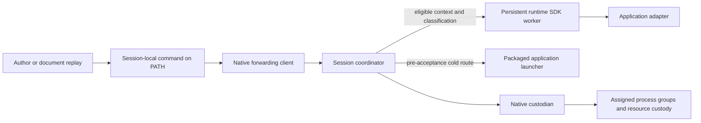

# Architecture

How can the same Markdown document run an ordinary command and later reuse an initialized application? mdrun keeps document execution separate from application reuse. The native Rust host still runs the document's interpreter; a managed session supplies a command on PATH that can forward eligible application calls to one cooperative worker.

For example, an application owner might provide a command named `mytool` and a document containing this hand-authored block:

````markdown
```sh
mytool inspect data.json
```
````

Here `mytool`, its `inspect` operation and `data.json` belong to the application and document author; mdrun does not generate them. Ordinary verification resolves `mytool` from the caller's PATH and launches it normally. Managed verification uses an explicit binding for the prepared application. The shell sees the same command, but its session-local PATH entry forwards the call to the host, which chooses the warm worker or the independent packaged-cold launcher before acceptance. The document need not embed SDK calls or worker startup logic.

The [product contract](PRODUCT.md) owns supported behavior and goals; the [execution checklist](plans/execution.md) owns qualification. Public session, SDK and batch contracts are frozen for the 0.1.0 release candidate. Native implementation protocols remain revision-local. Artifact qualification and publication are separate gates, and the mechanisms below do not establish general application cleanup. To prepare a binding and run this workflow, follow the [session guide](guides/sessions.md).

## Host and document engine

The document engine recognizes executable blocks and recorded results while retaining source spans. This lets authoring commands change selected content without reformatting untouched Markdown, and lets discovery show the same blocks that replay will execute.

| Component | Responsibility |
| --- | --- |
| [CLI](../src/cli.rs) and [help](../src/cli/help.rs) | Clap owns public parsing, validation, usage, terminators and help; hidden native-control entry points are excluded from public manuals. |
| [Application commands](../src/app.rs) | Coordinate document edits, interpreter execution, replay/output comparisons, extraction, images and remote delivery. |
| [Document engine](../src/document.rs) | Recognize source-spanned blocks and provenance, render new entries and change selected spans while retaining untouched bytes. |
| [Discovery](../src/discovery.rs) | Read the same parsed blocks for inventory and exact fenced-source preview without executing commands. |
| [Guides](../src/guides.rs) and [manual generator](../src/manual.rs) | Embed maintained Markdown guides; generate checked manual pages from the public clap tree and reference guide using development-only dependencies. |
| [Remote delivery](../src/remote.rs) | Send compatible document updates after local edits; transport warnings do not roll back the local document. |

Ordinary `exec` and `verify` launch `LANG -c CODE` with stdin at EOF and stdout/stderr merged into a capture. `exec` records output even on program failure; `verify` compares output rather than application status. Document rendering and stream transport have separate obligations: preserving native application bytes in a session does not make arbitrary bytes literal Markdown.

The host starts without JVM, Node or Python installations. A document's interpreter and a separately prepared worker require their own runtime.

## Session coordination and routing

A binding connects the name used in the document to two application-supplied launchers: a prepared SDK worker and an independent packaged-cold entry point. The [session host](../src/session/host.rs) validates that explicit [binding](../src/session/config.rs), captures native context before coordinator threads start, and creates private temporary configuration, credentials and an executable symlink under the binding name.

The author process inherits that symlink's directory at the front of PATH. The symlink is a session-generated entry point to mdrun, not application code and not the persistent worker. Each invocation reenters the native executable's [forwarding path](../src/main.rs), preserving application arguments instead of passing them through mdrun's command grammar. The [native client](../src/session/client.rs) captures the invocation context, removes mdrun's private injection, and connects through a private Unix socket with its standard descriptors. The separate worker process retains application initialization between accepted calls.



Each session has at most one sequential worker; explicit cold mode starts none. Before choosing warm execution, the host checks terminal descriptors, native encoding, cwd, environment and umask. A binding may explicitly qualify only the supported environment projections. Warm arguments and context must fit the UTF-8 worker boundary; cold execution retains native context.

The SDK classifier runs without application effects and may refuse a call before acceptance, allowing the host to choose the independent packaged launcher. Once invocation is requested, failure cannot cause a cold retry. Overlapping application calls, protocol violations, lost control or invalid completion poison the session rather than creating another worker attempt.

The [wire transport](../src/session/wire.rs) authenticates session/artifact identity and connection roles. Separate worker data and control connections keep output backpressure off the control path. Frames and payload chunks are bounded. Input is pulled only after an application read issues credit; stdout and stderr remain separate streams with a shared output sequence. Completion, client acknowledgement, worker release and client release are separate transitions. The host also observes worker process exit and native cleanup: application completion alone cannot certify session success.

### Waking the coordinator

The host's [wakeup mechanism](../src/session/wakeup.rs) uses a nonblocking Unix socket pair to notify the coordinator of readiness. Readers, writer completions and native handshakes first enqueue into their existing bounded channels, then notify. The coordinator clears old notifications before scanning those sources, so arrivals during the scan remain observable when it waits.

Each service pass checks deadlines, custody and control before processing bounded data work; progress immediately triggers another pass. With no progress, it polls the wake socket, native listener and standalone custody descriptor until the nearest deadline. Scoped custody receives notifications from the broker and detaches its notifier when the scope handle drops. Notifications contain no payload, and a full notification socket already represents pending work; transport queue capacities and backpressure remain unchanged. The broker and custodian retain separate lifecycle polling, and synchronous startup handshakes retain their existing time bounds. The [wakeup measurements](performance.md#coordinator-wakeup-measurements) describe the measured effect and its limits.

## Native ownership and batch scopes

A successful call does not prove that an application has stopped its background work or released external resources. The separate native [custodian](../src/session/custody.rs) owns resource-exclusion listeners and payload groups. Native anchors establish assigned process groups, pass owned descriptors and participate in launch/cleanup handshakes. Author, worker and cold processes run under this authority.

The coordinator does not infer cleanup from a direct-child exit or an empty stream. Custody must observe the supported groups' cleanup before releasing exclusions. Owner/control loss closes admission and initiates termination. Uncertain cleanup retains custody and diagnostic state instead of reporting success.

This is a cooperative process-group boundary. Managed code must retain descendants in assigned groups and stop/await its background work. Shell monitor mode, independent groups and daemonization are unsupported; escaped work is not reliably detected and may outlive an otherwise successful report. SDK application attestation complements native custody without expanding that boundary. The [protocol's ownership contract](plans/session-protocol.md#ownership-and-external-resources) records these limits.

For several documents, the [batch scheduler](../src/session/batch.rs) gives each admitted document a separate session and coordinates them through one [custody broker](../src/session/broker.rs) and custodian. The broker owns the native control connection and direct child, multiplexes bounded requests/events, and keeps stop/coordinator-loss signals observable independently of queue space. Scope and group identity is the pair `(scope, id)`, so siblings may use the same local group names. Both broker and custodian validate scope identity, admission state and event/request order; broker routing does not replace validation by the native authority. Impossible attribution or event overflow fails the batch.

Scheduling slots include startup, replay and cleanup. An observed document failure, including an output mismatch, stops new admission while healthy admitted peers drain within their budgets; custody-wide uncertainty can stop all scopes. All documents use one binding. Any declared resource limits effective concurrency to one unless sharing is explicitly selected. A clean document scope retains the batch's exclusion until every scope and batch cleanup finish. The [scheduling contract](plans/scheduling.md) owns these semantics and their qualification boundary.

## Runtime SDK and application adapter

Application owners supply the adapter that makes initialization reusable. The [JVM](../sdk/jvm/README.md), [Node](../sdk/node/README.md) and [Python](../sdk/python/README.md) SDKs implement shared transport and invocation lifecycle inside a dedicated application process; the host has no language-specific application branch. An adapter supplies side-effect-free classification, invocation through request-owned binary streams, reset attestation and orderly close.

Build preparation and immutable artifact identification belong to the application. The host neither builds the worker nor hashes its supplied artifact identity. Adapters must route real application output through request streams, reread mutable inputs as needed, and explicitly stop/await and inspect their own state and resources. SDK reset cannot restore arbitrary globals, modules, threads, timers, children or native handles. Late stream operations and protocol/callback faults invalidate reuse; detached work that never touches an SDK capability still needs application-owned checks.

Qualify the actual warm call against an independent packaged-cold launcher, checking bytes, statuses and relevant effects. A synthetic fixture or one runtime's controls do not qualify another application. Start with the runtime SDK guide, then use the [SDK consumption guide](sdk-distribution.md) to pin the prepared dependency in local and CI builds.

## Output, reports and evidence

Application output, report publication and cleanup have different completion conditions. Single-document captures live in the document command path. Batch stdout/stderr instead go to separate per-document disk spools, with no byte quota. A custody-owned publication subprocess copies finished groups in input order, so a slow earlier document delays later visible output and active-session limits do not bound accumulated spool storage. Owning the publisher as a native group lets cleanup deadlines cover blocked inherited output without changing shared descriptor flags or leaving an unjoinable writer thread.

After a batch infrastructure failure, finalization waits for admitted document coordinators to drain, then performs bounded broker cleanup. It does not wait indefinitely for a publisher with uncertain custody to become clean. The failure report preserves document outcomes and reports uncertain cleanup with its retained status path; command return does not certify resource release.

Batch-level diagnostics also use the native publisher, in a diagnostics-only mode that starts no children and claims no resource exclusions. The parent waits at most 500 ms before killing and reaping that known child; a separate one-second alarm bounds it if the parent disappears. This permits final errors after custody stops or becomes uncertain without blocking the coordinator on stderr. A blocked or broken diagnostic destination can lose this best-effort message; the exit status and requested report remain the machine-readable result.

Session results and batch aggregates contain metadata, route counts, application statuses, infrastructure failure and cleanup outcome, separate from application bytes and credentials. The shared [report publisher](../src/session/report.rs) writes a protected temporary file beside the destination and renames it after complete JSON is ready. This provides complete-file replacement, not crash durability. After successful preflight, it invalidates any previous report before managed execution. Report paths must not alias protected input/output/binding files; failed report publication fails the command. The [session guide](guides/sessions.md#version-1-reports) defines version 1 fields and distinguishes attempted routes, completed application statuses and session health.

Evidence must match the obligation being claimed. Maintained guides, parser guards, independent expected-result assertions, native lifecycle controls and runtime peers cover different obligations. Generated-man freshness proves agreement with source definitions, not every semantic claim. Local passes and historical hosted runs remain distinct from qualification of the current revision; the [implementation plan](PLAN.md#qualification-after-history-cleanup) records that boundary.
