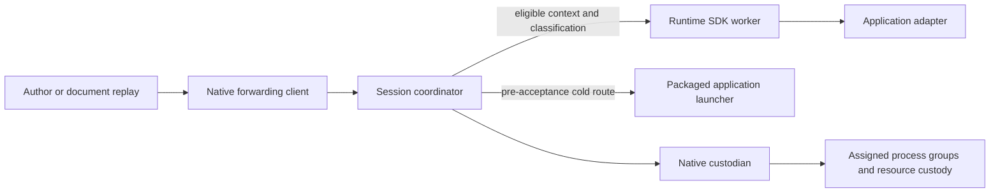

# Architecture

mdrun is a native Rust executable with two execution paths: ordinary document commands launch interpreters directly, while managed sessions can reuse one cooperative application worker. The [product contract](PRODUCT.md) owns behavior and goals; the [execution checklist](plans/execution.md) owns qualification. Public session, SDK and batch contracts are frozen for the 0.1.0 release candidate; native implementation protocols remain revision-local. Final artifact qualification and publication remain separate gates, and these mechanisms do not establish general application cleanup.

## Host and document engine

| Component | Responsibility |
| --- | --- |
| [CLI](../src/cli.rs) and [help](../src/cli/help.rs) | Clap owns public parsing, validation, usage, terminators and help; hidden native-control entry points are excluded from public manuals. |
| [Application commands](../src/app.rs) | Coordinate document edits, interpreter execution, replay/output comparisons, extraction, images and remote delivery. |
| [Document engine](../src/document.rs) | Recognize source-spanned blocks and provenance, render new entries and change selected spans while retaining untouched bytes. |
| [Discovery](../src/discovery.rs) | Read the same parsed blocks for inventory and exact fenced-source preview without executing commands. |
| [Guides](../src/guides.rs) and [manual generator](../src/manual.rs) | Embed maintained Markdown guides; generate checked manual pages from the public clap tree and reference guide using development-only dependencies. |
| [Remote delivery](../src/remote.rs) | Send compatible document updates after local edits; transport warnings do not roll back the local document. |

Ordinary `exec` and `verify` launch `LANG -c CODE` with stdin at EOF and stdout/stderr merged into a capture. `exec` records output even on program failure; `verify` compares output rather than application status. Document rendering is a separate boundary from stream transport: preserving native application bytes in a session does not make arbitrary bytes literal Markdown. The host starts without JVM, Node or Python installations; a document's interpreter and a separately prepared worker require their own runtime.

## Session coordination and routing

The [session host](../src/session/host.rs) validates an explicit [binding](../src/session/config.rs), captures native context before coordinator threads start, and creates private temporary configuration, credentials and a session-local executable symlink. The author inherits that directory at the front of PATH. Invoking the binding name reenters the native executable's [forwarding path](../src/main.rs), preserving application arguments instead of passing them through the mdrun command grammar. The [native client](../src/session/client.rs) captures its invocation context, removes mdrun's private injection, and connects through a private Unix socket with its standard descriptors.

Each session has at most one sequential worker. Explicit cold mode starts none. Context checks cover terminal descriptors, native encoding, cwd, environment and umask; a binding may explicitly qualify only the supported environment projections. Warm arguments and context must fit the UTF-8 worker boundary; cold execution retains the native context. The SDK classifier runs without application effects and may refuse an invocation before acceptance. The host can then choose the independent packaged launcher. Once invocation is requested, failure cannot cause a cold retry. Overlapping application calls, protocol violations, lost control or invalid completion poison the session rather than creating another worker attempt.

The [wire transport](../src/session/wire.rs) authenticates session/artifact identity and connection roles. A worker uses separate data and control connections, so output backpressure does not consume its control path. Frames and payload chunks are bounded. Input is pulled only after an application read issues credit; stdout and stderr remain separate streams with a shared output sequence. Completion, client acknowledgement, worker release and client release are separate transitions. The host also observes worker process exit and native cleanup: receiving application completion alone cannot certify session success.

The host's [wakeup mechanism](../src/session/wakeup.rs) carries readiness notifications through a nonblocking Unix socket pair. Readers, writer completions and native handshakes enqueue into their existing bounded channels before notifying. The coordinator clears old notifications before scanning those sources, so arrivals during the scan remain observable when it waits. Each service pass checks deadlines, custody and control before processing bounded data work; progress immediately triggers another pass. With no progress, it polls the wake socket, native listener and standalone custody descriptor until the nearest deadline. Scoped custody receives notifications from the broker and detaches its notifier when the scope handle drops. Notifications contain no payload, and a full notification socket already represents pending work; transport queue capacities and backpressure remain unchanged. The broker and custodian retain their separate lifecycle polling, and synchronous startup handshakes retain their existing time bounds.

## Native ownership and batch scopes

The [custodian](../src/session/custody.rs) is a separate native process that owns resource-exclusion listeners and payload groups. Native anchors establish assigned process groups, pass owned descriptors and participate in launch/cleanup handshakes. Author, worker and cold processes run under this authority. The coordinator does not infer cleanup from a direct-child exit or an empty stream; custody must observe the supported groups' cleanup before releasing exclusions. Owner/control loss closes admission and initiates termination. Uncertain cleanup retains custody and diagnostic state instead of reporting success.

This is a cooperative process-group boundary. Managed code must retain descendants in assigned groups and stop/await its background work. Shell monitor mode, independent groups and daemonization are unsupported; escaped work is not reliably detected and may outlive an otherwise successful report. The SDK's application attestation complements native custody but does not expand that boundary. The [protocol's ownership contract](plans/session-protocol.md#ownership-and-external-resources) records these limits.

The [batch scheduler](../src/session/batch.rs) gives each admitted document a separate session and coordinates them through one [custody broker](../src/session/broker.rs) and custodian. The broker owns the native control connection and direct child, multiplexes bounded requests/events, and keeps stop/coordinator-loss signals observable independently of queue space. Scope and group identity is the pair `(scope, id)`, allowing sibling scopes to use the same local group names. Both broker and custodian validate scope identity, admission state and event/request order; routing a message through the broker is not a substitute for native validation. Impossible attribution or event overflow fails the batch.

Slots include startup, replay and cleanup. An observed document failure, including an output mismatch, stops new admission while healthy admitted peers drain within their budgets; custody-wide uncertainty can stop all scopes. All documents use one binding. Any declared resource limits effective concurrency to one unless sharing is explicitly selected. A clean document scope retains the batch's exclusion until every scope and batch cleanup finish. The [scheduling contract](plans/scheduling.md) owns these semantics and their qualification boundary.

## Runtime SDK and application adapter

The [JVM](../sdk/jvm/README.md), [Node](../sdk/node/README.md) and [Python](../sdk/python/README.md) SDKs implement the shared transport and invocation lifecycle inside a dedicated application process. The host has no language-specific application branch. An adapter supplies side-effect-free classification, invocation through request-owned binary streams, reset attestation and orderly close. Build preparation and immutable artifact identification belong to the application; the host neither builds the worker nor hashes its supplied artifact identity.

Adapters must route real application output through request streams, reread mutable inputs as needed, and explicitly stop/await and inspect their own state and resources. SDK reset cannot restore arbitrary globals, modules, threads, timers, children or native handles. Late stream operations and protocol/callback faults invalidate reuse; detached work that never touches an SDK capability still needs application-owned checks. Qualification compares the actual warm call with an independent packaged-cold launcher, including bytes, statuses and relevant effects. A synthetic fixture or one runtime's controls do not qualify another application.

## Output, reports and evidence

Single-document captures live in the document command path. Batch stdout/stderr instead go to separate per-document disk spools, with no byte quota, and a custody-owned publication subprocess copies finished groups in input order. A slow earlier document delays later visible output; active-session limits do not bound accumulated spool storage. Owning the publisher as a native group permits cleanup deadlines to cover blocked inherited output without mutating shared descriptor flags or leaving an unjoinable writer thread.

After a batch infrastructure failure, finalization waits for admitted document coordinators to drain and then performs bounded broker cleanup. It does not wait indefinitely for a publisher whose custody is uncertain to become clean. The failure report preserves document outcomes and reports uncertain cleanup with its retained status path; returning from the command does not certify resource release.

Batch-level diagnostics also use the native publisher, in a diagnostics-only mode that starts no children and claims no resource exclusions. The parent waits at most 500 ms before killing and reaping that known child; a separate one-second alarm bounds it if the parent disappears. This allows final errors to be reported after custody stops or becomes uncertain without blocking the coordinator on stderr. A blocked or broken diagnostic destination can lose this best-effort message; the exit status and requested report remain the machine-readable result.

Session results and batch aggregates contain metadata, route counts, application statuses, infrastructure failure and cleanup outcome, separate from application bytes and credentials. The shared [report publisher](../src/session/report.rs) writes a protected temporary file beside the destination and renames it after the complete JSON is ready; this provides complete-file replacement, not a crash-durability promise. After successful preflight, it invalidates any previous report before managed execution. The [session guide](guides/sessions.md#version-1-reports) owns version 1 field meanings and explicitly distinguishes attempted routes, completed application statuses and session health. Report paths must not alias protected input/output/binding files; a failed report publication fails the command.

The maintained guides, parser guards, independent expected-result assertions, native lifecycle controls and runtime peers cover different obligations. Generated-man freshness proves agreement with the source definitions, not every semantic claim. Local passes and historical hosted runs remain distinct from qualification of the current revision; the [implementation plan](PLAN.md#qualification-after-history-cleanup) records that evidence boundary.
